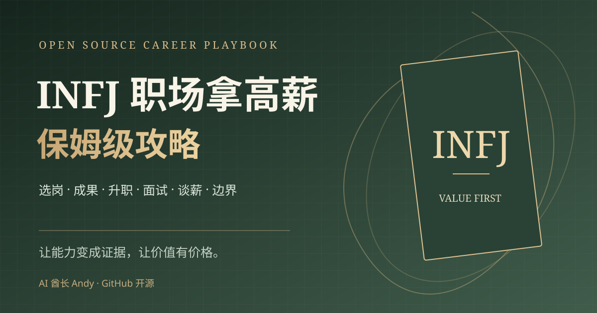

# INFJ 职场拿高薪保姆级攻略

> **INFJ 如何摆脱高付出、低回报？** 一套从职业定位、薪酬调研、成果表达、晋升、跳槽到谈薪的开源执行手册。
>
> **拿高薪没有人格捷径。** 我们把 MBTI 当成切入问题的标签，用市场数据、实际成果与行动计划解决问题。

**AI 酋长 Andy** · [我的官网 metaver.vip](https://metaver.vip/) · [求职咨询 / 高管成长陪跑](https://metaver.vip/services) · **微信：`AIPMAndy`**



## 🌐 在线阅读

**[打开互动网站](https://aipmandy.github.io/infj-high-salary-guide/)** ｜ **[7 天启动方案](START-HERE.md)** ｜ **[30 天行动计划](https://aipmandy.github.io/infj-high-salary-guide/#plan)**

## 这份攻略解决什么

如果你遇到过这些情况，可以从这里开始：

- 项目做得不少，绩效评价不错，但**加薪没有下文**。
- 同事表达几句话就能拿走关注，自己的贡献**难以量化和归因**。
- 明明有能力，面试时却只能说「我很有责任心，善于沟通」。
- HR 一问期望薪资就慌，不知道怎么比 **12 / 13 / 14 薪**与奖金。
- 想转型 AI 产品、策略、客户成功或管理岗位，却不知道**先补哪块能力**。
- 担心谈钱、拒绝额外工作会破坏关系。

## 六步拿高薪方法

| 步骤 | 核心问题 | 最终交付物 |
| --- | --- | --- |
| 01 职业定位 | 什么岗位值得我投入？ | 两个目标岗位 + JD 要求矩阵 |
| 02 市场定价 | 市场如何给类似能力定价？ | 同城市 / 级别薪酬证据表 |
| 03 成果证据 | 哪些贡献值得更高薪酬？ | 三条可核验的 PAR 成果链 |
| 04 升职路径 | 怎样从「好用」升级为「有影响力」？ | 晋升一页纸 + 评估节点 |
| 05 薪资谈判 | 加薪 / 跳槽时怎么开口？ | 谈判区间、证据、备选方案 |
| 06 边界与续航 | 怎样不被无底线加活拖垮？ | 工作优先级与边界沟通记录 |

从 [01 选岗](guides/01-positioning.md) 开始，按顺序阅读 [02 定价](guides/02-market-value.md) → [03 成果表达](guides/03-evidence.md) → [04 晋升](guides/04-promotion.md) → [05 谈薪](guides/05-negotiation.md) → [06 边界](guides/06-boundaries.md)。

## 项目里有什么

**[交互网站](https://aipmandy.github.io/infj-high-salary-guide/)** 可以直接使用以下功能：

| 功能 | 用途 |
| --- | --- |
| 10 条职业发展方向 | 按产品 / 策略 / 商业 / 管理 / 专业筛选，列出入门条件、价值杠杆和常见误区 |
| 12 段可复制沟通话术 | 加薪、晋升、边界、成果、面试、Offer 谈薪 |
| 年现金总包计算器 | 用月固定薪资、发薪月数和现金奖金对比，不伪造市场行情 |
| 30 天可勾选计划 | 四周 30 个具体动作，支持浏览器保存、TXT 导出与重置 |
| 4 份可复制文档模板 | 成果台账、加薪一页纸、面试案例卡、Offer 决策表 |

**注意：** 30 天行动计划的目标是取得阶段性材料和谈判能力，**并不保证 30 天涨薪**。

## 先做一个 7 天版本

| 天数 | 具体动作 | 交付物 |
| --- | --- | --- |
| Day 1 | 列出过去一年最有价值的 5 个项目 | 真实项目清单 |
| Day 2 | 选 3 个项目写成 PAR 证据卡 | 成果简报 |
| Day 3 | 定义城市、行业、岗位、目标职级 | 岗位清单 |
| Day 4 | 采样 10 个有效 JD 并拆必备能力 | JD 对照表 |
| Day 5 | 比较同城市同职级的薪酬信息 | 市场薪酬区间草表 |
| Day 6 | 找一个可靠同行模拟面试 / 讲述成果 | 反馈与迭代 |
| Day 7 | 选择晋升或跳槽的下一步 | 一页行动决策 |

完整版见 [START-HERE.md](START-HERE.md) 和网站 30 天交互清单。

## 免费资源模板

- [成果证据台账](templates/achievement-ledger.md)：5 个项目归档与 3 条量化成果
- [升职加薪一页纸](templates/raise-onepager.md)：会前准备、会中问题、会后追踪
- [面试案例卡](templates/interview-story.md)：PAR + 反思 + 深挖问题
- [Offer 对比决策表](templates/offer-comparison.md)：固定、奖金、股权、风险与取舍

## 关于 INFJ：必须讲清楚

INFJ 的讨论热度很高，但 **MBTI 不适合预测收入、工作能力或未来职级**。MBTI 官方也明确不建议将其用于招聘筛选。任何人格类型的人都可能在产品、管理、销售、研究、咨询等工作取得成果。你可以用「我是否容易为了和谐而回避冲突」这种问题做自省，但不要用「INFJ 天生不会赚钱」限制职业选择。

每项建议应根据：**岗位要求 × 已有技能 × 项目证据 × 薪酬市场 × 个人约束** 来调整。

参考来源、适用范围与假设见 [docs/SOURCES.md](docs/SOURCES.md)。

## 和作者交流

我是 **AI 酋长 Andy**，曾在腾讯、百度从事 AI 产品工作，做过 AI 创业公司 VP，目前从事求职咨询、高管成长陪跑、AI 业务应用相关服务。

- 免费自学：[互动网站](https://aipmandy.github.io/infj-high-salary-guide/)
- **我的微信：`AIPMAndy`**（微信搜索添加，备注「INFJ 职场攻略」，请简单说说你的职业问题）
- **我的官网：[metaver.vip](https://metaver.vip/)**
- 有个性化需求：[求职咨询与陪跑服务](https://metaver.vip/services)
- 内容纠错 / 投稿：[GitHub Issues](https://github.com/AIPMAndy/infj-high-salary-guide/issues)
- 欢迎 **Star ⭐ / Fork / PR**，尤其欢迎补充不同城市、行业、职级的可公开验证资料。

**不承诺具体加薪幅度、晋升、Offer 或收益。** 不搜集用户填写的薪资、个人经历等信息：网站计算在浏览器本地执行，任务记录留在 localStorage，仅当用户主动点击导出时生成本地文本。

## 技术与维护

无需框架、后端、CDN、Token 或安装依赖：

```bash
python3 -m http.server 8000
# 在浏览器打开 http://localhost:8000/
python3 -m unittest discover -s tests -v
```

- `index.html`：网站页面与 SEO
- `assets/site.css`：排版、配色、响应式样式
- `assets/site.js`：搜索、筛选、复制、计算器与计划进度
- `data/content.js`：10 条岗位、12 个沟通场景、30 天任务数据源
- `guides/`：六章细化指南
- `templates/`：可直接复制的文档模板
- `docs/`：来源、质量检查、发布说明
- `.github/workflows/deploy-pages.yml`：静态站 GitHub Actions 自动部署

部署参见 [docs/PUBLISH.md](docs/PUBLISH.md)，参与贡献参见 [CONTRIBUTING.md](CONTRIBUTING.md)。原创项目代码与编辑内容按 [MIT License](LICENSE) 开源，第三方商标、品牌与外部资料的权利归原权利人。
